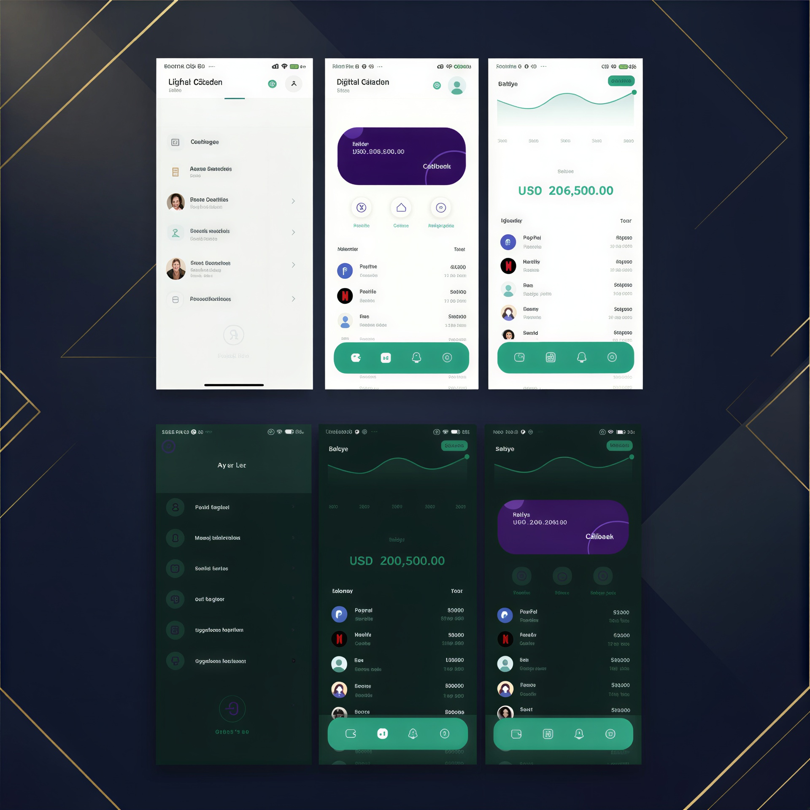

# Dompet — Digital Wallet App

<p align="center">
  
</p>

<p align="center">
  A Flutter-based digital wallet application featuring a clean interface, multilingual support, and a theme that adapts to your device.
</p>

<p align="center">
  <strong>English · 中文 · Türkçe</strong>
</p>

---

## Overview

**Dompet** is a digital wallet application built with Flutter. It provides a simple interface for exploring wallet-related features, managing account information, and simulating common financial operations.

The application combines Firebase authentication, local SQLite storage, interactive charts, and embedded WebView functionality within a responsive mobile experience.

Its interface supports multiple languages and automatically adapts to the device's Light or Dark theme.

## Features

### Authentication & Account
- Firebase authentication with Google and GitHub sign-in.
- Guest mode for accessing the application without signing in.
- Profile and account-related functionality.

### Wallet & Transactions
- Simulated payments, transfers, and balance top-ups.
- Local transaction and message data management using SQLite.
- Wallet-related information and financial activity views.

*Note: Financial operations are simulated for application demonstration purposes. They do not represent real banking transactions.*

### User Interface & Customization
- Modern Emerald & Midnight color palette.
- Light and Dark themes with automatic system preference detection.
- Three supported languages:
  - English
  - Chinese (中文)
  - Turkish (Türkçe)
- Language selection from both the Home screen and Profile section.
- Responsive layouts for different mobile screen sizes.

### Additional Functionality
- Application logging and log inspection using the Logger package.
- Interactive line charts powered by `fl_chart`.
- Embedded web content through WebView.
- Device interaction and debugging utilities.
- Region-aware date and number formatting.
- Support for different currency display formats.

## Screenshots & Demo

### Design Reference

<p align="center">
  
</p>

### Application Demo

<p align="center">
  
</p>

## Tech Stack

- **Framework:** Flutter
- **Language:** Dart
- **State Management & Navigation:** GetX
- **Authentication:** Firebase Authentication
- **Local Database:** SQLite
- **Local Storage:** GetStorage
- **Charts:** fl_chart
- **Embedded Browser:** flutter_inappwebview
- **Networking:** Dio
- **Localization & Formatting:** GetX Localization, intl
- **Logging:** logger
- **Permissions:** permission_handler

## Key Packages

This project uses several packages from the Flutter and Dart ecosystem, including:

- `flutter_inappwebview`
- `web_socket_channel`
- `permission_handler`
- `connectivity_plus`
- `mobile_scanner`
- `auto_size_text`
- `google_sign_in`
- `firebase_core`
- `firebase_auth`
- `path_provider`
- `synchronized`
- `fluttertoast`
- `image_picker`
- `audioplayers`
- `google_fonts`
- `get_storage`
- `share_plus`
- `fl_chart`
- `sqflite`
- `convert`
- `encrypt`
- `crypto`
- `logger`
- `intl`
- `path`
- `dio`
- `get`

## Getting Started

### Prerequisites

- Flutter SDK
- Dart SDK
- Android Studio or another supported Flutter development environment

### Installation

1. Clone the repository:

   ```bash
   git clone <YOUR_REPOSITORY_URL>
   ```

2. Navigate to the project directory:

   ```bash
   cd Dompet.flutter
   ```

3. Install dependencies:

   ```bash
   flutter pub get
   ```

4. Run the application:

   ```bash
   flutter run
   ```

## Acknowledgments

- Special thanks to the Pixso community for providing the original design draft, especially [しょうた](https://pixso.cn/community/file/OKp9_CF9BjALdzxa2W-3UA).
- This project was developed with the help of free packages and tools created and published by other developers and the open-source community.
- Special thanks to the developers and contributors who make these packages and tools available.

All third-party packages remain the property of their respective authors and are subject to their own licenses.

## Project Information

- **Project Name:** Dompet
- **Framework:** Flutter
- **Supported Platforms:** Android and iOS
- **Languages:** English, Chinese, and Turkish
- **Theme:** Light and Dark (System Adaptive)
- **License:** MIT (see the `LICENSE` file)
